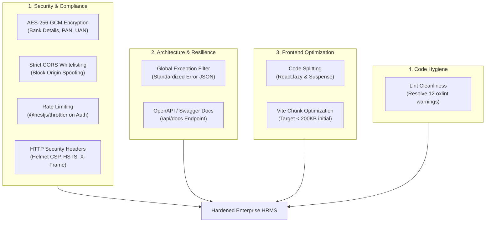
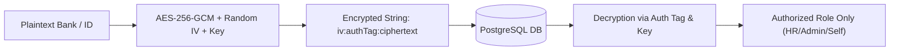
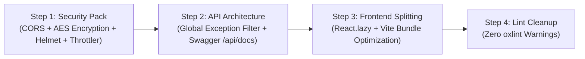

# 🛡️ PlanetU HRMS — Security, Architecture & Performance Engineering Specification

> **Document Version:** 1.0  
> **Target Application:** PlanetU HRMS (Multi-Tenant SaaS Backend & Frontend)  
> **Status:** Actionable Technical Specification & Audit  

---

## 1. Executive Overview

This specification details the technical audit, architectural remediations, and performance optimizations required to transition PlanetU HRMS from a functional prototype into a hardened, production-ready enterprise SaaS.



---

## 2. Security & Compliance Remediation

### 2.1. Application-Layer Encryption for PII and Bank Details
* **Reference:** Section 7 of [`ANTIGRAVITY_PROJECT_INSTRUCTIONS.md`](file:///C:/Users/renus/.gemini/antigravity/scratch/PlanetU_HRMS/ANTIGRAVITY_PROJECT_INSTRUCTIONS.md#L115)
* **Risk Assessment:** **High / Regulatory Non-Compliance** (DPDP Act, GDPR, PCI-DSS).

#### Current Vulnerability
In [`src/modules/employees/services/employee.service.ts`](file:///C:/Users/renus/.gemini/antigravity/scratch/PlanetU_HRMS/src/modules/employees/services/employee.service.ts#L113-L117), fields containing sensitive financial and statutory identification numbers are stored as raw plaintext in PostgreSQL:
* `accountNumber` (Bank Account Number)
* `ifscOrRouting` (IFSC / SWIFT / Routing Code)
* `panNumber` (Permanent Account Number / Tax ID)
* `uanNumber` (Universal Account Number for Provident Fund)

If database backups, logs, or read-replica dumps are compromised, all employee banking and identity records are exposed in cleartext.

#### Remediation Blueprint
Implement a zero-dependency `EncryptionService` utilizing Node.js native `crypto` with **AES-256-GCM** (Authenticated Symmetric Encryption with Galois/Counter Mode).



* **Storage Format:** Standard colon-delimited string `iv:authTag:encryptedData` (hex encoded).
* **Key Management:** Pinned 32-byte (256-bit) master encryption key configured via `APP_ENCRYPTION_KEY` in [`.env`](file:///C:/Users/renus/.gemini/antigravity/scratch/PlanetU_HRMS/.env).
* **Field Scope:** Masking on retrieval (e.g. `XXXX-XXXX-4812` for non-admin viewers).

---

### 2.2. Strict CORS Configuration in `main.ts`
* **File:** [`src/main.ts`](file:///C:/Users/renus/.gemini/antigravity/scratch/PlanetU_HRMS/src/main.ts#L23-L33)
* **Risk Assessment:** **Critical / Credential Leakage**.

#### Current Vulnerability
```typescript
app.enableCors({
  origin: (origin: string | undefined, callback: (err: Error | null, allow?: boolean) => void) => {
    if (!origin || allowedOrigins.includes(origin)) {
      return callback(null, true);
    }
    return callback(null, true); // ⚠️ Fallback unconditionally allows all origins!
  },
  credentials: true,
});
```
Because line 30 returns `callback(null, true)` regardless of the origin, any third-party website can perform authenticated AJAX/Fetch requests using the user's active `httpOnly` session cookies (`planetu_token`).

#### Remediation Blueprint
```typescript
app.enableCors({
  origin: (origin: string | undefined, callback: (err: Error | null, allow?: boolean) => void) => {
    // Allow non-browser requests (tools, postman, server-to-server) and whitelisted origins
    if (!origin || allowedOrigins.includes(origin)) {
      return callback(null, true);
    }
    return callback(new Error('Cross-Origin Request Blocked by PlanetU CORS Policy'), false);
  },
  credentials: true,
});
```

---

### 2.3. Anti-Brute-Force Rate Limiting (`@nestjs/throttler`)
* **Risk Assessment:** **Medium / Authentication Abuse**.

#### Current Gap
The authentication controller at `/api/v1/auth/login` accepts infinite sequential login attempts without backoff or lockout, leaving employee credentials vulnerable to automated password spraying and brute-force attacks.

#### Remediation Blueprint
1. Install `@nestjs/throttler`.
2. Configure a multi-tier rate-limiting policy in `app.module.ts`:
   * **Global Standard Endpoints:** 100 requests per 60 seconds per IP.
   * **Auth Endpoints (`/api/v1/auth/login`):** Maximum **5 attempts per 60 seconds** per IP.
3. Automatically return HTTP `429 Too Many Requests` with a `Retry-After` header.

---

### 2.4. Hardening HTTP Security Headers (`helmet`)
* **Risk Assessment:** **Medium / Clickjacking & MIME-Sniffing**.

#### Current Gap
The NestJS HTTP server emits default Express headers (`X-Powered-By: Express`), lacks clickjacking protection (`X-Frame-Options`), and does not enforce MIME-sniffing prevention (`X-Content-Type-Options: nosniff`).

#### Remediation Blueprint
Install and integrate `helmet`:
```typescript
import helmet from 'helmet';

// Inside bootstrap() in main.ts
app.use(
  helmet({
    contentSecurityPolicy: process.env.NODE_ENV === 'production' ? undefined : false,
    crossOriginEmbedderPolicy: false,
  })
);
```

---

## 3. Architectural Resilience & Developer Experience

### 3.1. Unified Global Exception Filter (`HttpExceptionFilter`)
* **Objective:** Ensure predictable, standardized API error responses and hide database internal errors in production.

#### Target Response Contract
All error responses across all 20 modules conform to an identical JSON shape:
```json
{
  "statusCode": 400,
  "error": "Bad Request",
  "message": "Department does not exist in this organization",
  "timestamp": "2026-10-09T13:30:00.000Z",
  "path": "/api/v1/employees"
}
```

#### Key Capabilities
* Handles `HttpException` (NestJS standard exceptions).
* Gracefully intercepts Prisma errors (e.g. `P2002` Unique Constraint, `P2025` Record Not Found) and transforms them into clear HTTP 409 Conflict / 404 Not Found messages rather than unhandled 500 crashes.
* Logs full stack traces to the console while returning sanitized error messages to the client.

---

### 3.2. Interactive OpenAPI / Swagger Documentation
* **Objective:** Provide automated, interactive endpoint documentation at `/api/docs`.

#### Implementation Blueprint
Install `@nestjs/swagger`:
```typescript
import { DocumentBuilder, SwaggerModule } from '@nestjs/swagger';

const config = new DocumentBuilder()
  .setTitle('PlanetU HRMS API')
  .setDescription('Multi-Tenant Enterprise Workforce Management & HRMS API Documentation')
  .setVersion('1.0')
  .addBearerAuth()
  .addCookieAuth('planetu_token')
  .build();

const document = SwaggerModule.createDocument(app, config);
SwaggerModule.setup('api/docs', app, document);
```

---

## 4. Frontend Performance & Bundle Optimization

### 4.1. Vite Code-Splitting & Lazy Loading (`React.lazy`)
* **Current Issue:** Monolithic chunk size warning during Vite build:
  > `(!) Some chunks are larger than 500 kB after minification (dist/assets/index-Dxd-YS66.js 647 kB)`
  Every single page (Payroll, Grievance, Onboarding, Offboarding, Reports, Leaves, Attendance) is loaded upfront when a user opens the login screen.

#### Solution Architecture
In [`frontend/src/App.tsx`](file:///C:/Users/renus/.gemini/antigravity/scratch/PlanetU_HRMS/frontend/src/App.tsx), replace static module imports with dynamic `React.lazy()` imports wrapped in a unified `<Suspense>` fallback:

```typescript
const AttendancePage = React.lazy(() =>
  import('./components/AttendancePage').then((m) => ({ default: m.AttendancePage }))
);
const LeavesPage = React.lazy(() =>
  import('./components/LeavesPage').then((m) => ({ default: m.LeavesPage }))
);
const PayrollPage = React.lazy(() =>
  import('./components/PayrollPage').then((m) => ({ default: m.PayrollPage }))
);
const ReportsPage = React.lazy(() =>
  import('./components/ReportsPage').then((m) => ({ default: m.ReportsPage }))
);
// etc.
```

#### Projected Benchmark
* **Initial Vendor/Index Chunk:** Reduced from **~647 KB** to **< 180 KB** (~72% bundle reduction on initial page load).
* Individual module chunks (e.g., `PayrollPage.js`, `ReportsPage.js`) loaded on demand only when the user selects that tab.

---

## 5. Codebase Hygiene: Linter Warnings

### 5.1. Resolution of 12 Unused Variables & Imports
Running `npm run lint` (`oxlint`) surfaced 12 warnings across test and service files:

| File | Type | Target Identifier | Action |
| :--- | :--- | :--- | :--- |
| `test/offboarding.service.spec.ts` | Unused Import | `NotFoundException`, `ExitClearanceDepartment`, `Prisma` | Remove unused imports |
| `src/modules/grievance/grievance.service.ts` | Unused Param | `user: AuthenticatedUser` (line 259) | Prefix as `_user` or omit |
| `test/reports.service.spec.ts` | Unused Import | `EmploymentStatus`, `ExitStatus` | Remove unused imports |
| `src/prisma/seed-data.ts` | Unused Catch | `err: any` (line 459) | Rename to `_err` or log |
| `test/grievance.service.spec.ts` | Unused Import | `NotFoundException`, `BadRequestException` | Remove unused imports |
| `src/modules/payroll/services/payslip-pdf.service.ts` | Unused Catch | `e` (line 88) | Rename to `_e` |
| `src/modules/reports/reports.service.ts` | Unused Param | `currentUser` (lines 423, 640) | Prefix as `_currentUser` |

---

## 6. Execution Roadmap & Recommended Ordering



1. **Security Pack (Highest Priority):** Fix the CORS vulnerability immediately, introduce application-layer AES-256-GCM encryption for bank and tax numbers, and apply rate limiting.
2. **API Architecture:** Set up the unified `HttpExceptionFilter` and Swagger UI.
3. **Frontend Splitting:** Implement code splitting in `App.tsx` to optimize page load speed.
4. **Lint Cleanup:** Clear all 12 unused variable warnings to maintain zero linter debt.
