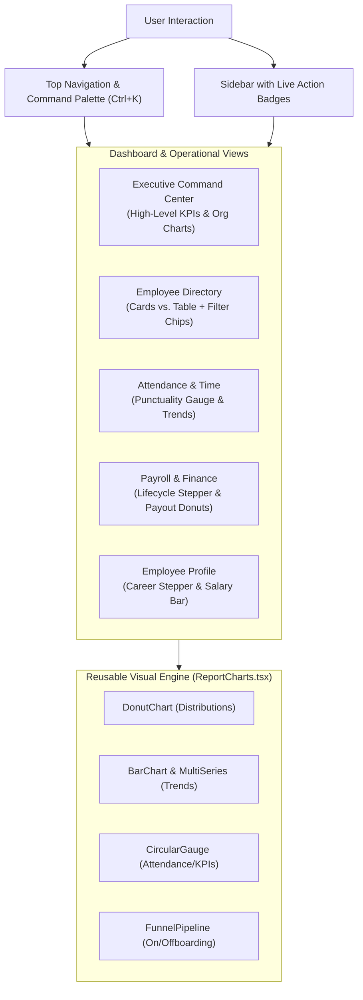
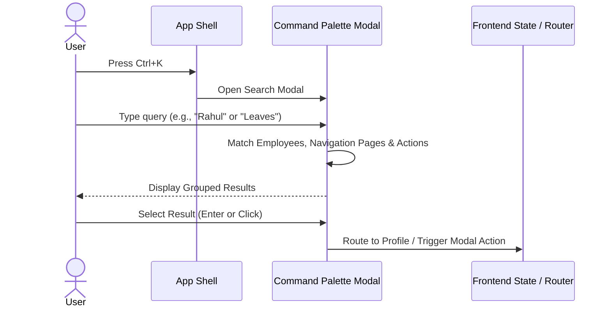

# 🪐 PlanetU HRMS — Visual KPIs, Charts & Navigation Enhancement Plan

> **Document Version:** 1.0  
> **Target Application:** PlanetU HRMS (Multi-Tenant SaaS)  
> **Scope:** Frontend UI/UX, Executive Visuals, Navigation Architecture, and Data Visualization  

---

## 1. Executive Summary & Objective

PlanetU HRMS currently possesses an enterprise-grade backend foundation with 20 service domains, robust multi-tenant data isolation, and comprehensive functional coverage. However, the current web frontend presents information primarily through **flat data tables and text forms**, while existing custom SVG visualization components (`DonutChart`, `BarChart`, `CircularGauge`, `FunnelPipeline` in `ReportCharts.tsx`) remain confined solely to the Reports section.

### Core Objectives
1. **Elevate Information Density with Visual KPIs:** Enable leadership, HR administrators, and team managers to evaluate organizational health in under 5 seconds through high-contrast KPI metric cards, progress indicators, and charts.
2. **Streamline Navigation & Discoverability:** Eliminate tedious sub-menu clicking by introducing a **Global Command Palette (`Ctrl + K`)**, **live sidebar action badges**, and **one-click filter chips**.
3. **Enhance Detail Views with Tactile Visuals:** Transition text-heavy sections (e.g., job history ledgers, compensation breakdowns, onboarding checklists) into interactive timelines, status steppers, and segmented visual bars.

---

## 2. System Architecture & UI Information Flow



---

## 3. High-Priority Enhancement Proposals

### 3.1. Executive HR Command Center (Overview Dashboard)
Currently, administrators land either in the Self-Service tab or a raw employee list. The **Executive Command Center** serves as the central operational hub for `CLIENT_SUPER_ADMIN` and `HR_ADMIN`.

#### A. Top Metric KPI Strip
* **Total Headcount:** Total active employees, net change (+X this month), and probation ratio.
* **Today's Attendance Rate:** Calculated percentage (e.g., `94.2%`) accompanied by a compact `CircularGauge` with count badges (`Present: 47`, `Late: 2`, `Absent: 1`).
* **On Leave Today:** Current out-of-office count with a hover drawer listing affected employees and substitute assignees.
* **Payroll Cycle Status:** Visual status pill (`Draft` / `Calculated` / `Verified` / `Locked` / `Disbursed`) with cutoff countdown timer.
* **Action Required Center:** Aggregated badge counter for items requiring immediate supervisor/HR signature:
  * Pending Leave Requests
  * Pending Resignations / Clearances
  * Unresolved Grievances
  * Expiring Probation Confirmations

#### B. Embedded Visual Analytics
1. **Department Headcount Distribution:** Interactive `DonutChart` depicting staff concentration across departments (Engineering, Operations, Sales, HR, Finance).
2. **Weekly Punctuality & Attendance Trend:** `MultiSeriesBarChart` tracking arrival trends over the previous 7 operational days.
3. **Upcoming Milestone Cards:** Carousel or compact list highlighting upcoming work anniversaries, birthdays, and public holidays for the week.

---

### 3.2. Module-Level Visual KPI Banners & Directory Grid

#### A. Employee Directory (`EmployeeListPage.tsx`)
* **KPI Metric Strip:**
  * `Active Employees` (Count + % of total capacity)
  * `On Probation` (Count + alert pill if probation ends within 14 days)
  * `Notice Period` (Count + link to offboarding clearance pipeline)
  * `New Joiners (Last 30 Days)`
* **Interactive Filter Chips (One-Click Filtering):**
  Replace nested dropdowns with tactile pills at the top of the directory:
  * `[ All (50) ]` `[ Active (45) ]` `[ Probation (3) ]` `[ Notice (2) ]` `[ Engineering (22) ]` `[ Operations (14) ]`
* **Dual View Mode Switch:**
  * `[ ☷ Cards View ]` vs. `[ ☰ Table View ]`
  * **Cards View:** Displays clean cards featuring employee avatar initials, full name, employee code (`ENG-0001`), designation, department tag, reporting manager, direct email/phone buttons, and action menu.

#### B. Employee Profile Detail View (`EmployeeProfileView.tsx`)
* **Visual Career & Job History Timeline:**
  Replace the current tabular history with an interactive vertical timeline/stepper showing milestones (Joining, Department Transfers, Role Changes, Promotions, Grade Adjustments) with dates and reason notes.
* **Compensation Component Breakdown Bar:**
  A segmented horizontal visual bar displaying exact proportions of the compensation package:
  * **Basic Pay (50%)** (Blue)
  * **House Rent Allowance (30%)** (Emerald)
  * **Special & Other Allowances (20%)** (Violet)
  * Deductions breakdown preview (PF, Professional Tax, TDS).

---

### 3.3. Time, Attendance & Leave Visualizations

#### A. Attendance Management (`AttendancePage.tsx`)
* **Punctuality Metric Ring:** `CircularGauge` indicating on-time percentage against standard shift start times.
* **Daily Status Bar:** Visual stacked progress bar showing distribution of `On Time`, `Grace Period Late`, `Half Day`, `Leave`, and `Loss of Pay`.
* **Biometric Punch Timeline:** Visual daily punch tracker depicting In-Time, Out-Time, and calculated active working duration vs. expected hours.

#### B. Leave Management (`LeavesPage.tsx`)
* **Leave Balance Gauge Cards:** Compact donut gauges for each leave bucket:
  * Casual Leave (`CL`): Remaining vs. Allocated
  * Sick Leave (`SL`): Remaining vs. Allocated
  * Privilege / Earned Leave (`PL`): Remaining vs. Allocated
* **Department Leave Calendar / Visual Strip:** Horizontal timeline showing who is scheduled to be out of the office over the upcoming 14 days to prevent team understaffing.

---

### 3.4. Payroll & Finance Lifecycle Visualizer

#### A. 5-Stage Payroll Pipeline Stepper
Visual interactive horizontal pipeline displaying current progress of the monthly payroll cycle:
```
[ 1. Draft Data ] ──► [ 2. Attendance Synced ] ──► [ 3. Batch Computed ] ──► [ 4. Verified & Locked ] ──► [ 5. Disbursed ]
```

#### B. Salary Disbursement Distribution
* **Gross vs. Net vs. Deductions Donut:**
  Visual comparison of total company wage liability against employee net payouts and statutory payments (EPFO, ESIC, State Tax Authorities).

---

### 3.5. Navigation & Discoverability Upgrades

#### A. Global Command Palette (`Ctrl + K` / `Cmd + K`)


* **Capabilities:**
  * **People Search:** Direct fuzzy search by name, code (`ADM-0001`), email, or phone.
  * **Page Navigation:** Instant jumping (`Go to Shifts`, `Go to Payroll`, `Go to Grievances`).
  * **Quick Actions:** Execute immediate modal triggers (`+ Add Employee`, `+ Apply Leave`, `+ Submit Resignation`).

#### B. Live Action Badges on Navigation Sidebar
Display dynamic badge counts directly beside sidebar tab items to highlight pending tasks:
* **Leaves:** `3 Pending` (Amber badge)
* **Grievances:** `1 Open` (Red badge)
* **Onboarding:** `2 Candidates` (Blue badge)
* **Offboarding:** `1 Clearance` (Purple badge)

#### C. Interactive Breadcrumbs
Replace flat page headers with clickable breadcrumb navigation:
`Workforce` > `Employees` > `Rahul Sharma (ENG-0001)` > `Job History`

---

## 4. Phased Implementation Roadmap

| Phase | Focus Area | Deliverables | Impact |
| :--- | :--- | :--- | :--- |
| **Phase 1** | **Directory & Quick Wins** | 1. Metric KPI summary banner on Employee Directory<br/>2. Tactile one-click filter chips (`Active`, `Probation`, `Depts`)<br/>3. Toggle between Cards Grid and Data Table | Immediate high visual impact on the most frequently used page |
| **Phase 2** | **Navigation Upgrades** | 1. Global Command Palette (`Ctrl + K` modal)<br/>2. Dynamic notification/action badges on sidebar tabs<br/>3. Clickable breadcrumbs on detail pages | Dramatically reduces click fatigue and search time |
| **Phase 3** | **Executive Overview** | 1. Dedicated Executive Command Center tab<br/>2. Real-time department distribution donut chart<br/>3. 7-Day Attendance trend bar chart<br/>4. Milestone cards (Birthdays/Anniversaries) | Transforms the system into an executive-ready dashboard |
| **Phase 4** | **Rich Detail Views** | 1. Visual Job History & Promotion Stepper<br/>2. Compensation Component Breakdown Bar<br/>3. Payroll 5-Stage Lifecycle Stepper | Provides intuitive visual explanations for complex data |

---

> [!TIP]
> **Implementation Note:** All visual charts utilize the built-in, lightweight SVG charting components already implemented in [`ReportCharts.tsx`](file:///C:/Users/renus/.gemini/antigravity/scratch/PlanetU_HRMS/frontend/src/components/ReportCharts.tsx). This guarantees **zero external bundle overhead** (no heavy third-party charting libraries like Chart.js or Recharts required), maintaining rapid load times and crisp rendering.
