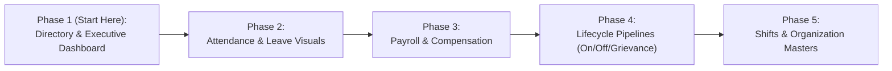

# 🪐 PlanetU HRMS — Comprehensive Visual KPI, Chart & Architecture Audit

> **Document Type:** Production Architecture Audit & Phased Implementation Plan  
> **Status:** Pending User Approval (No source files modified)  
> **Scope:** 11 Functional Modules, Data Visualization, Calculation Integrity, RBAC & Tenant Scoping  

---

## 1. Executive Summary & Audit Methodology

PlanetU HRMS has a mature backend foundation spanning 20 service domains, Prisma ORM v6, and a dedicated SVG charting library in [`ReportCharts.tsx`](file:///C:/Users/renus/.gemini/antigravity/scratch/PlanetU_HRMS/frontend/src/components/ReportCharts.tsx). However, visual analytics and KPI metrics are currently siloed almost exclusively in the **Reports & Analytics tab**, leaving everyday operational workflows (Employee Directory, Attendance, Leaves, Payroll, Onboarding, Offboarding, Grievances, Shifts, and Masters) dependent on **flat data tables and text forms**.

### Core Constraints & Architecture Safeguards
1. **Reuse Existing Infrastructure:** No external charting dependencies (no Chart.js, Recharts, or D3). We reuse the existing, zero-dependency SVG chart components in `ReportCharts.tsx` (`DonutChart`, `BarChart`, `MultiSeriesBarChart`, `CircularGauge`, `FunnelPipeline`).
2. **True Aggregate Metrics:** Company-wide metrics must **never** be computed from paginated client-side subsets. All summary cards and charts derive from authoritative backend aggregations scoped to the tenant.
3. **Strict RBAC & Tenant Isolation:** Every metric is scoped by `organizationId`. Field-level privacy (e.g. salary visibility restricted to `FINANCE`/`HR_ADMIN`/`CLIENT_SUPER_ADMIN`; grievance anonymity; manager direct-report scoping) is strictly preserved.
4. **Calculations Before Visuals:** Timezone, denominator, and holiday exclusion flaws identified in attendance and payroll must be acknowledged and corrected to avoid visualizing flawed data.

---

## 2. Critical Calculation & Timezone Audit (Pre-Implementation Findings)

Before building new visual metrics on existing calculations, our audit identified the following mathematical and temporal flaws in the codebase:

### Issue A: Attendance Timezone Drift in `truncateToDateOnly` & Check-In
* **Location:** [`attendance.service.ts` (L37-L39, L77)](file:///C:/Users/renus/.gemini/antigravity/scratch/PlanetU_HRMS/src/modules/attendance/attendance.service.ts#L37-L39)
* **Code:**
  ```typescript
  private truncateToDateOnly(d: Date): Date {
    return new Date(Date.UTC(d.getFullYear(), d.getMonth(), d.getDate()));
  }
  const punchMinutes = checkInTime.getHours() * 60 + checkInTime.getMinutes();
  ```
* **The Bug:** `d.getFullYear()`, `d.getMonth()`, `d.getDate()`, and `d.getHours()` extract time based on the **host operating system's local timezone**, not the organization's timezone. In a Docker container or Linux server running in UTC, an employee checking in at 09:15 AM IST (03:45 AM UTC) has `punchMinutes = 225`. Comparing `225` against shift start time `"09:00"` (`540` minutes) causes severe lateness and date-assignment drift.
* **Impact on Visuals:** Lateness gauges and daily attendance counts will report incorrect percentages when deployed on cloud/Docker runtimes.
* **Remediation Plan:** Standardize attendance time calculations to the organization's configured timezone (default `Asia/Kolkata` / IST) or utilize UTC-anchored hour extraction.

---

### Issue B: Mid-Month Unexcused Absence & In-Progress Month Denominator Flaw
* **Location:** [`attendance.service.ts` (L493-L548)](file:///C:/Users/renus/.gemini/antigravity/scratch/PlanetU_HRMS/src/modules/attendance/attendance.service.ts#L493-L548)
* **Code:**
  ```typescript
  for (let day = 1; day <= totalMonthDays; day++) {
    // If no punch and no leave found:
    unexcusedAbsenceDays += 1;
  }
  ```
* **The Bug:** The loop iterates through every day of the month up to `totalMonthDays` (e.g. 30 or 31). If this calculation is queried mid-month (e.g. on the 11th of October), all **future days (October 12th to 31st) are categorized as UNEXCUSED ABSENCES**! This artificially deflates payable days to 11 and inflates absence rates to >60%.
* **Impact on Visuals:** Any mid-month attendance or payable days gauge will show catastrophic absenteeism for active employees.
* **Remediation Plan:** Cap the evaluation of unexcused absences strictly to `Math.min(currentDay, totalMonthDays)` for in-progress months, treating future calendar dates as `PENDING_CYCLE`.

---

### Issue C: Paid Public Holidays Ignored in Payable Days
* **Location:** [`attendance.service.ts` (L517-L546)](file:///C:/Users/renus/.gemini/antigravity/scratch/PlanetU_HRMS/src/modules/attendance/attendance.service.ts#L517-L546)
* **The Bug:** While weekly off days (`Shift.weeklyOffDays`) and approved leaves (`LeaveRequest`) are checked, the calculation **never queries the `Holiday` table**.
* **Impact on Visuals & Payroll:** Official company holidays (e.g. Gandhi Jayanti, Diwali) that fall on weekdays are marked as unexcused absences if the employee did not punch in, improperly deducting pay.
* **Remediation Plan:** Query the tenant's `Holiday` table for the month and treat matching holiday dates as paid non-working days.

---

### Issue D: Today's Presence Rate Denominator Flaw
* **Location:** [`reports.service.ts` (L93-L96)](file:///C:/Users/renus/.gemini/antigravity/scratch/PlanetU_HRMS/src/modules/reports/reports.service.ts#L93-L96)
* **Code:**
  ```typescript
  const presenceRate = activeHeadcount > 0 ? Number(((todayPunches / activeHeadcount) * 100).toFixed(1)) : 0;
  ```
* **The Bug:** The denominator is total active headcount (`activeHeadcount`), including employees who are on approved leave or whose shift has today as a weekly off.
* **Impact on Visuals:** On weekends or days with approved leaves, the presence rate erroneously drops (e.g. showing 10% on a Sunday even though 100% of scheduled staff are present).
* **Remediation Plan:** Refine denominator to `scheduledHeadcountToday = activeHeadcount - (weeklyOffToday + onLeaveToday)`.

---

### Issue E: Client-Side Paginated Metrics in Directory
* **Location:** [`EmployeeListPage.tsx` (L150, L163)](file:///C:/Users/renus/.gemini/antigravity/scratch/PlanetU_HRMS/frontend/src/components/EmployeeListPage.tsx#L150)
* **Code:**
  ```typescript
  {employees.length} Total  // Computes length from paginated data array (e.g., 20)
  {activeCount} Active      // Filters client-side page 1 array
  ```
* **The Bug:** Company-wide employee counts are computed from the current page's slice rather than true database totals.
* **Remediation Plan:** Enhance backend `listEmployees` or leverage `api.getWorkforceReports()` to deliver true aggregate counts (`total`, `active`, `probation`, `noticePeriod`).

---

## 3. Comprehensive Module-by-Module Audit (11 Tables)

Below is the verified audit for all 11 modules, mapping existing implementations against database models, RBAC rules, and recommended visual enhancements.

---

### Module 1: Executive / ESS Dashboard
* **Primary Files:** [`EssDashboardPage.tsx`](file:///C:/Users/renus/.gemini/antigravity/scratch/PlanetU_HRMS/frontend/src/components/EssDashboardPage.tsx), [`ess.service.ts`](file:///C:/Users/renus/.gemini/antigravity/scratch/PlanetU_HRMS/src/modules/ess/ess.service.ts), [`reports.service.ts`](file:///C:/Users/renus/.gemini/antigravity/scratch/PlanetU_HRMS/src/modules/reports/reports.service.ts)

| Dimension | Specification |
| :--- | :--- |
| **1. Existing KPIs & Visuals** | Personal ESS: Punch status pill, leave balance summary cards (Used/Total), next 4 upcoming holidays list, latest payslip net pay card. Manager: Simple text banner with `directReportsCount` and `pendingLeaveApprovalsCount`. No executive charts. |
| **2. Missing / Incomplete KPIs** | **For Admins/HR:** Org headcount growth, today's attendance rate %, on-leave today count, monthly payroll run status, open grievance count, pending onboarding/offboarding count. **For Employees:** Monthly attendance punctuality score, leave burn rate, leave balance progress ring. |
| **3. Recommended Charts / Visuals** | **For Admins (`CLIENT_SUPER_ADMIN`, `HR_ADMIN`, `FINANCE`):**<br/>• Top 5 Metric Strip: Headcount, Scheduled vs Present Today, On Leave Today, Payroll Status, Action Required Count.<br/>• `DonutChart`: Department Headcount Distribution.<br/>• `MultiSeriesBarChart`: 7-Day Attendance Trend (Present vs. Late vs. Leave).<br/>• `CircularGauge`: Today's Punctuality / On-Time Arrival Score.<br/>**For Employees:** `CircularGauge` for Shift Attendance Punctuality & Leave Quota Utilization ring. |
| **4. Required Data & Status** | Exists in database (`Employee`, `AttendanceRecord`, `LeaveRequest`, `PayrollBatch`, `Grievance`). Analytics aggregations already exist in `reports.service.ts` (`getExecutiveOverview`, `getWorkforceAnalytics`, `getAttendanceAnalytics`). |
| **5. Backend / API Changes** | Combine `getExecutiveOverview` with departmental breakdown in a single lightweight endpoint `/api/v1/ess/executive-summary` (or wire existing `/api/v1/reports/overview` directly to the dashboard when user is Admin/HR). |
| **6. Role & Privacy Restrictions** | • `EMPLOYEE`: Sees only own personal ESS gauges & team holiday list.<br/>• `MANAGER`: Sees direct reports' attendance & pending approvals.<br/>• `FINANCE`: Sees payroll expenses and headcount, but not POSH grievance details.<br/>• `HR_ADMIN` / `SUPER_ADMIN`: Full organization-wide executive view. |
| **7. Implementation Priority** | **P1 (Immediate - High Impact)** |

---

### Module 2: Employee Directory and Employee Profiles
* **Primary Files:** [`EmployeeListPage.tsx`](file:///C:/Users/renus/.gemini/antigravity/scratch/PlanetU_HRMS/frontend/src/components/EmployeeListPage.tsx), [`EmployeeProfileView.tsx`](file:///C:/Users/renus/.gemini/antigravity/scratch/PlanetU_HRMS/frontend/src/components/EmployeeProfileView.tsx), [`employee.service.ts`](file:///C:/Users/renus/.gemini/antigravity/scratch/PlanetU_HRMS/src/modules/employees/services/employee.service.ts)

| Dimension | Specification |
| :--- | :--- |
| **1. Existing KPIs & Visuals** | Raw badges: `{employees.length} Total` (buggy, paginated), `{activeCount} Active`. Status badges (`ACTIVE`, `PROBATION`, `NOTICE_PERIOD`, `TERMINATED`). Tabular job history ledger in profile. |
| **2. Missing / Incomplete KPIs** | Organization-wide headcount counts: Total Active, On Probation (with alert for <14 days remaining), Notice Period, New Hires (Last 30 Days). Profile: Compensation distribution breakdown, service tenure indicator. |
| **3. Recommended Charts / Visuals** | • **Directory Top KPI Strip:** 4 Metric tiles (`Total Active`, `Probation Watchlist`, `Notice Period`, `New Hires`).<br/>• **View Toggle:** `[ ☷ Cards Grid | ☰ Table View ]` featuring employee initials, department chip, manager name, and direct action pills.<br/>• **Tactile Filter Chips:** Quick single-click filter pills (`All`, `Active`, `Probation`, `Notice`, by top departments).<br/>• **Profile Career Stepper:** Vertical visual milestone timeline replacing flat table for `EmployeeJobHistory`.<br/>• **Profile Salary Bar:** Horizontal segmented bar showing Basic (50%) vs HRA (25%) vs Special (25%). |
| **4. Required Data & Status** | Exists in DB (`Employee`, `Department`, `EmployeeJobHistory`, `SalaryStructure`). |
| **5. Backend / API Changes** | Modify `listEmployees` return payload to include metadata counters: `{ meta: { totalActive, totalProbation, totalNotice, newJoinersThisMonth } }` to eliminate client-side paginated counting. |
| **6. Role & Privacy Restrictions** | Field-level RBAC enforced in `employee-rbac.service.ts`: Managers and peers cannot view salary, bank account, PAN, or UAN numbers. Only `HR_ADMIN`, `CLIENT_SUPER_ADMIN`, `FINANCE`, and the employee themselves see financial blocks. |
| **7. Implementation Priority** | **P1 (Immediate - High Impact)** |

---

### Module 3: Reports & Analytics
* **Primary Files:** [`ReportsPage.tsx`](file:///C:/Users/renus/.gemini/antigravity/scratch/PlanetU_HRMS/frontend/src/components/ReportsPage.tsx), [`ReportCharts.tsx`](file:///C:/Users/renus/.gemini/antigravity/scratch/PlanetU_HRMS/frontend/src/components/ReportCharts.tsx), [`reports.service.ts`](file:///C:/Users/renus/.gemini/antigravity/scratch/PlanetU_HRMS/src/modules/reports/reports.service.ts)

| Dimension | Specification |
| :--- | :--- |
| **1. Existing KPIs & Visuals** | Comprehensive SVG charts: `DonutChart` (Departments, Gender, Leave Types), `MultiSeriesBarChart` (Attendance trends, Payroll components), `CircularGauge` (Presence Rate), `BarChart` (Designations, Turnover). |
| **2. Missing / Incomplete KPIs** | • Net Headcount Run Rate: Hires minus exits trend line over last 6 months.<br/>• Absence Cost Estimation: Total Loss-of-Pay days multiplied by average daily cost.<br/>• Cross-filtering sync: Selecting a department in the filter dropdown does not currently filter all sub-charts consistently. |
| **3. Recommended Charts / Visuals** | • `MultiSeriesBarChart`: Headcount Growth vs Exits (6-month comparative bar).<br/>• `BarChart`: Department Absenteeism Comparison (identifies departments with high unplanned absence).<br/>• Synchronized Date Range Picker (From/To) applied universally across all analytics queries. |
| **4. Required Data & Status** | Exists in database (`Employee`, `AttendanceRecord`, `LeaveRequest`, `PayrollBatch`). |
| **5. Backend / API Changes** | Enhance `ReportQueryDto` to support explicit `startDate` and `endDate` across all 6 report endpoints (`/workforce`, `/attendance`, `/leaves`, `/payroll`, `/lifecycle`). |
| **6. Role & Privacy Restrictions** | Role restriction: `FINANCE` sees payroll reports but not onboarding candidate records. `MANAGER` is strictly scoped to direct reports. |
| **7. Implementation Priority** | **P2 (High)** |

---

### Module 4: Time & Attendance
* **Primary Files:** [`AttendancePage.tsx`](file:///C:/Users/renus/.gemini/antigravity/scratch/PlanetU_HRMS/frontend/src/components/AttendancePage.tsx), [`attendance.service.ts`](file:///C:/Users/renus/.gemini/antigravity/scratch/PlanetU_HRMS/src/modules/attendance/attendance.service.ts)

| Dimension | Specification |
| :--- | :--- |
| **1. Existing KPIs & Visuals** | Today's punch card (In/Out time, duration), tabular attendance records with status badges (`PRESENT`, `HALF_DAY`, `LATE`, `WEEKLY_OFF`, `ABSENT`). Regularization modal. |
| **2. Missing / Incomplete KPIs** | Organization / Team Punctuality Rate %, Total Hours Worked vs Expected Hours, Overtime / Grace Period utilization count, Unexcused Absence Count for current cycle. |
| **3. Recommended Charts / Visuals** | • **Daily Attendance Summary Strip:** Cards for `Present On Time`, `Late Arrivals`, `Half-Days`, `On Leave`, `Unexcused Absences`.<br/>• `CircularGauge`: Team / Personal Punctuality Score (e.g. 92% on-time arrivals).<br/>• **Punch Visualizer:** Timeline bar showing Check-In, Check-Out, and Active Working Span against the 9-hour shift schedule.<br/>• **Payable Days Summary Card:** Real-time breakdown of current month payable units (`Present + (HalfDay * 0.5) + WeeklyOff + PaidLeave`). |
| **4. Required Data & Status** | Exists in DB (`AttendanceRecord`, `Shift`, `Holiday`). Requires fixing the timezone & mid-month absence bugs detailed in Section 2. |
| **5. Backend / API Changes** | Add an endpoint `GET /api/v1/attendance/summary` returning today's roll-call totals for managers/HR: `{ present, late, halfDay, onLeave, weeklyOff, unrecorded }`. |
| **6. Role & Privacy Restrictions** | `EMPLOYEE` sees only personal attendance logs. `MANAGER` sees direct reports. `HR_ADMIN` and `CLIENT_SUPER_ADMIN` see all tenant records. |
| **7. Implementation Priority** | **P2 (High)** |

---

### Module 5: Leave Management
* **Primary Files:** [`LeavesPage.tsx`](file:///C:/Users/renus/.gemini/antigravity/scratch/PlanetU_HRMS/frontend/src/components/LeavesPage.tsx), [`leave.service.ts`](file:///C:/Users/renus/.gemini/antigravity/scratch/PlanetU_HRMS/src/modules/leaves/leave.service.ts)

| Dimension | Specification |
| :--- | :--- |
| **1. Existing KPIs & Visuals** | Personal balance cards (`CL`, `SL`, `PL`, `LWP` with available/allowed/pending numbers). Pending approval tables. Policy list. |
| **2. Missing / Incomplete KPIs** | Organization leave utilization rate, team members currently on leave today, annual leave liability (accrued untaken paid leaves), leave rejection rate. |
| **3. Recommended Charts / Visuals** | • **Team Out-Of-Office Strip:** Visual banner showing team members currently on leave today and upcoming over the next 7 days.<br/>• **Leave Balance Progress Rings / Gauges:** Circular gauge per leave type displaying `Used / Allowed` with remaining balance.<br/>• `DonutChart`: Leave Type Consumption Share (`CL` vs `SL` vs `PL` vs `LWP`). |
| **4. Required Data & Status** | Exists in DB (`LeaveRequest`, `LeaveTransaction`, `LeaveType`). |
| **5. Backend / API Changes** | Expose a team out-of-office summary in `GET /api/v1/leaves/out-of-office` for managers and HR admins. |
| **6. Role & Privacy Restrictions** | Medical reasons in Sick Leave (`SL`) requests protected from broad disclosure. Employees view only their own balances. |
| **7. Implementation Priority** | **P2 (High)** |

---

### Module 6: Payroll & Compliance
* **Primary Files:** [`PayrollPage.tsx`](file:///C:/Users/renus/.gemini/antigravity/scratch/PlanetU_HRMS/frontend/src/components/PayrollPage.tsx), [`payroll.service.ts`](file:///C:/Users/renus/.gemini/antigravity/scratch/PlanetU_HRMS/src/modules/payroll/payroll.service.ts)

| Dimension | Specification |
| :--- | :--- |
| **1. Existing KPIs & Visuals** | Selected batch metric cards: `Batch Status`, `Employees Processed`, `Total Gross Earnings`, `Total Deductions (PF+PT)`, `Total Net Take-Home`. Table of employee payslips. |
| **2. Missing / Incomplete KPIs** | MoM Payroll Expense Growth %, Statutory Liability Totals (Employer PF + Employee PF + PT), Average Net Salary per Employee, Disbursal vs Pending reconciliation. |
| **3. Recommended Charts / Visuals** | • **5-Stage Batch Lifecycle Stepper:** Visual interactive progress tracker (`Draft Calculated` ➔ `Attendance Reconciled` ➔ `Adjustments Applied` ➔ `Locked` ➔ `Disbursed`).<br/>• `DonutChart`: Wage Distribution (`Net Pay: 82%`, `Provident Fund: 14%`, `Professional Tax: 4%`).<br/>• `MultiSeriesBarChart`: 6-Month Gross vs Net Payout Trend. |
| **4. Required Data & Status** | Exists in DB (`PayrollBatch`, `Payslip`, `PayrollAdjustment`, `SalaryStructure`). |
| **5. Backend / API Changes** | Enhance `getBatchById` response to return breakdown totals for PF (Employee + Employer share), PT, and gross addition categories. |
| **6. Role & Privacy Restrictions** | **Strict Financial Confidentiality:** Accessible strictly to `FINANCE`, `HR_ADMIN`, and `CLIENT_SUPER_ADMIN`. Regular employees and managers have zero access to this console. |
| **7. Implementation Priority** | **P3 (Medium)** |

---

### Module 7: Onboarding
* **Primary Files:** [`OnboardingPage.tsx`](file:///C:/Users/renus/.gemini/antigravity/scratch/PlanetU_HRMS/frontend/src/components/OnboardingPage.tsx), [`onboarding.service.ts`](file:///C:/Users/renus/.gemini/antigravity/scratch/PlanetU_HRMS/src/modules/onboarding/onboarding.service.ts)

| Dimension | Specification |
| :--- | :--- |
| **1. Existing KPIs & Visuals** | Text status filter pills (`INVITED`, `SUBMITTED`, `CONVERTED`), Candidate table with status badges and checklist modal. |
| **2. Missing / Incomplete KPIs** | Total Candidates in Pipeline, Pre-boarding Submission Rate %, Average Days to Convert, Pending Document Verification Count. |
| **3. Recommended Charts / Visuals** | • **Pipeline Metric Summary:** Top cards for `Active Pipeline`, `Invited (Pending Form)`, `Submitted (Ready for Review)`, `Converted (This Month)`.<br/>• `FunnelPipeline` (from `ReportCharts.tsx`): Candidate stages (`Invited` ➔ `In Progress` ➔ `Submitted` ➔ `Converted`).<br/>• **Checklist Progress Bar:** Compact progress indicator inside candidate rows (`4 / 6 tasks completed - 67%`). |
| **4. Required Data & Status** | Exists in DB (`OnboardingCandidate`, `OnboardingTask`). |
| **5. Backend / API Changes** | Add task completion count (`completedTasks`, `totalTasks`) to the `listCandidates` query return object. |
| **6. Role & Privacy Restrictions** | Pre-boarding bank details and tax IDs restricted to `HR_ADMIN` and `CLIENT_SUPER_ADMIN`. |
| **7. Implementation Priority** | **P3 (Medium)** |

---

### Module 8: Offboarding & Exit
* **Primary Files:** [`OffboardingPage.tsx`](file:///C:/Users/renus/.gemini/antigravity/scratch/PlanetU_HRMS/frontend/src/components/OffboardingPage.tsx), [`offboarding.service.ts`](file:///C:/Users/renus/.gemini/antigravity/scratch/PlanetU_HRMS/src/modules/offboarding/offboarding.service.ts)

| Dimension | Specification |
| :--- | :--- |
| **1. Existing KPIs & Visuals** | Status dropdown filter, exit requests data table, modal dialogs for Resignation, Manager Action, Department Clearance, Exit Interview, and FnF Settlement. |
| **2. Missing / Incomplete KPIs** | Total Active Exits in Notice Period, Clearances Pending by Department (IT / HR / Admin / Finance), FnF Pending Settlement Amount, Primary Resignation Drivers. |
| **3. Recommended Charts / Visuals** | • **Exit Summary Strip:** Metric cards for `In Notice Period`, `Pending Manager Approval`, `Clearance Blocked`, `FnF Ready for Payout`.<br/>• `DonutChart`: Exit Reason Category Breakdown (Career Growth, Compensation, Personal, Relocation).<br/>• **Department Clearance Matrix / Progress Bar:** 4-segment visual indicator (IT [✓], Admin [✓], Finance [⌛], HR [✓]). |
| **4. Required Data & Status** | Exists in DB (`ExitRequest`, `ExitClearanceTask`, `ExitInterview`, `FnFSettlement`). |
| **5. Backend / API Changes** | Add clearance status summary to `getExitRequests` payload (`itCleared`, `adminCleared`, `financeCleared`, `hrCleared`). |
| **6. Role & Privacy Restrictions** | Exit Interview feedback is confidential to HR/Super Admin. Managers see only direct reports' notice dates and their own clearance tasks. |
| **7. Implementation Priority** | **P3 (Medium)** |

---

### Module 9: Grievance Management & POSH Redressal
* **Primary Files:** [`GrievanceManagementPage.tsx`](file:///C:/Users/renus/.gemini/antigravity/scratch/PlanetU_HRMS/frontend/src/components/GrievanceManagementPage.tsx), [`grievance.service.ts`](file:///C:/Users/renus/.gemini/antigravity/scratch/PlanetU_HRMS/src/modules/grievance/grievance.service.ts)

| Dimension | Specification |
| :--- | :--- |
| **1. Existing KPIs & Visuals** | Metric cards: `Total Cases Filed`, `Active In-Progress`, `Urgent Active Cases`, `Resolved Cases`. Status and priority badges. Timeline modal. |
| **2. Missing / Incomplete KPIs** | Average Resolution Time (in days), Cases Breaching SLA (>30 days open), POSH / ICC Case Count, Employee Satisfaction Rating on Closed Cases. |
| **3. Recommended Charts / Visuals** | • `DonutChart`: Case Category Distribution (Harassment & POSH, Safety, Payroll, Leadership, Policy).<br/>• **SLA Health Meter:** Progress bar showing compliance with statutory 30/90-day resolution guidelines.<br/>• **Priority Breakdown Bar:** Visual horizontal bar showing Urgent vs High vs Medium vs Low ratio. |
| **4. Required Data & Status** | Exists in DB (`Grievance`, `GrievanceTimeline`). Stats endpoint `getGrievanceStats` already exists in `grievance.service.ts`. |
| **5. Backend / API Changes** | Add category counts and average resolution days to `getGrievanceStats` response payload. |
| **6. Role & Privacy Restrictions** | **Highest Confidentiality:** Anonymous grievances must NEVER expose `employeeId` or `userId`. POSH cases restricted strictly to Internal Complaints Committee (`ICC`) / `HR_ADMIN`. |
| **7. Implementation Priority** | **P3 (Medium)** |

---

### Module 10: Shift Scheduling & Rostering
* **Primary Files:** [`ShiftsPage.tsx`](file:///C:/Users/renus/.gemini/antigravity/scratch/PlanetU_HRMS/frontend/src/components/ShiftsPage.tsx), [`shift.service.ts`](file:///C:/Users/renus/.gemini/antigravity/scratch/PlanetU_HRMS/src/modules/shifts/shift.service.ts)

| Dimension | Specification |
| :--- | :--- |
| **1. Existing KPIs & Visuals** | List of shift template cards (Start/End time, Grace period, Overnight flag). Modal for individual shift assignment. |
| **2. Missing / Incomplete KPIs** | Total Employees Assigned per Shift, Unassigned Headcount (employees without an active roster), Coverage Ratio per day of week (Monday through Sunday). |
| **3. Recommended Charts / Visuals** | • **Roster Metric Cards:** `Active Shifts Configured`, `Employees Assigned`, `Unassigned Watchlist`.<br/>• `DonutChart`: Headcount Share by Shift Template (e.g. Day Shift: 85%, Evening: 10%, Night: 5%).<br/>• **Day-of-Week Working Headcount Bar:** Bar chart displaying scheduled staffing levels Monday through Sunday to prevent weekend staffing shortages. |
| **4. Required Data & Status** | Exists in DB (`Shift`, `EmployeeShiftAssignment`, `Employee`). |
| **5. Backend / API Changes** | Add an aggregation endpoint `GET /api/v1/shifts/distribution` returning employee counts grouped by shift and weekly off days. |
| **6. Role & Privacy Restrictions** | Accessible to `MANAGER` (for direct reports), `HR_ADMIN`, and `CLIENT_SUPER_ADMIN`. |
| **7. Implementation Priority** | **P4 (Standard)** |

---

### Module 11: Organization & Masters
* **Primary Files:** [`OrganizationMastersPage.tsx`](file:///C:/Users/renus/.gemini/antigravity/scratch/PlanetU_HRMS/frontend/src/components/OrganizationMastersPage.tsx), [`masters.service.ts`](file:///C:/Users/renus/.gemini/antigravity/scratch/PlanetU_HRMS/src/modules/masters/masters.service.ts)

| Dimension | Specification |
| :--- | :--- |
| **1. Existing KPIs & Visuals** | Tab badges for count of master items: `Departments (4)`, `Designations (8)`, `Grades (5)`, `Locations (2)`, `Holidays (10)`. Department profile drawer with head designation. |
| **2. Missing / Incomplete KPIs** | Departments missing assigned Department Heads, Average Span of Control (employees per manager), Headcount distribution across office locations. |
| **3. Recommended Charts / Visuals** | • **Master Summary Strip:** Metric cards for `Total Units`, `Unassigned Dept Heads`, `Total Offices`, `Holidays Remaining This Year`.<br/>• `DonutChart`: Location Headcount Distribution (e.g. Pune HQ vs Bengaluru Branch).<br/>• **Grade Level Pyramid:** Visual hierarchy bar showing headcount distribution from Grade L1 through L5. |
| **4. Required Data & Status** | Exists in DB (`Department`, `Designation`, `Grade`, `Location`, `Holiday`, `Employee`). |
| **5. Backend / API Changes** | Enhance `getDepartments` to return employee counts (`_count: { employees: true }`) for direct visual display. |
| **6. Role & Privacy Restrictions** | Management of master structures restricted to `HR_ADMIN` and `CLIENT_SUPER_ADMIN`. Read-only lookup for others. |
| **7. Implementation Priority** | **P4 (Standard)** |

---

## 4. Prioritized Implementation Roadmap

Following the directive to build **one phase at a time**, starting with the **Employee Directory and Executive Dashboard**, here is the sequential execution plan:



### Phase 1: Employee Directory & Executive Command Center (Starting Point)
1. **Employee Directory Upgrades ([`EmployeeListPage.tsx`](file:///C:/Users/renus/.gemini/antigravity/scratch/PlanetU_HRMS/frontend/src/components/EmployeeListPage.tsx)):**
   - Add authoritative top KPI banner: Total Active Headcount, Probation Watchlist, Notice Period, New Hires (Last 30 Days).
   - Implement `[ ☷ Cards Grid | ☰ Table View ]` view toggle.
   - Add one-click tactile filter chips (`All`, `Active`, `Probation`, `Notice`, by Department).
   - Fix client-side paginated counting bug.
2. **Executive Command Center Dashboard:**
   - Integrate `ReportsService.getExecutiveOverview` into an Executive Overview view for `CLIENT_SUPER_ADMIN` and `HR_ADMIN`.
   - Embed `DonutChart` (Department Headcount Distribution) and `MultiSeriesBarChart` (7-Day Attendance Trend).
   - Embed circular gauge for today's punctuality and out-of-office count.

### Phase 2: Time & Attendance + Leave Management (With Calculation Fixes)
1. **Attendance Engine Hardening:**
   - Correct timezone offset and mid-month unexcused absence calculation in `attendance.service.ts`.
   - Include `Holiday` records in payable days evaluation.
2. **Attendance & Leave Visualizations:**
   - Add Daily Attendance Roll-Call summary cards (Present, Late, Half-Day, Absent, On Leave).
   - Add `CircularGauge` for team punctuality rate.
   - Add Leave Balance progress rings and team Out-Of-Office timeline strip in `LeavesPage.tsx`.

### Phase 3: Payroll & Compliance Lifecycle
1. Implement 5-Stage Payroll Lifecycle Stepper (`Draft` ➔ `Attendance Reconciled` ➔ `Adjustments` ➔ `Locked` ➔ `Disbursed`).
2. Add `DonutChart` for Net Take-Home vs PF vs Professional Tax.
3. Add Employee Profile Salary Component horizontal breakdown bar.

### Phase 4: Lifecycle Pipelines (Onboarding, Offboarding & Grievances)
1. Onboarding: Embed `FunnelPipeline` and candidate checklist progress bars (`X / Y tasks completed`).
2. Offboarding: Add exit reason `DonutChart` and 4-department clearance status matrix (`IT`, `HR`, `Admin`, `Finance`).
3. Grievances: Add category share `DonutChart` and SLA resolution health meter.

### Phase 5: Shift Scheduling & Organization Masters
1. Shift coverage bar chart (Monday to Sunday headcount allocation).
2. Department headcount bars and Location distribution donut.

---

## 5. Verification & Testing Requirements

To ensure zero regressions across existing functionality:
1. **Metric Aggregation Tests:** Unit tests in `test/reports.service.spec.ts` verifying that headcount, probation, and notice period calculations reflect true database counts across pagination limits.
2. **Timezone & Absence Tests:** Tests in `test/attendance.service.spec.ts` verifying:
   - Mid-month date evaluation does not mark future calendar dates as unexcused absences.
   - Company holidays are treated as paid non-working days.
3. **Filter & Permission Tests:** Verifying that department filters in reports and directory restrict rows to the specified tenant and reporting manager boundaries.
4. **Visual Component Rendering:** Verifying that zero data or single-employee tenants render informative empty states instead of division-by-zero (`NaN%`) errors.
